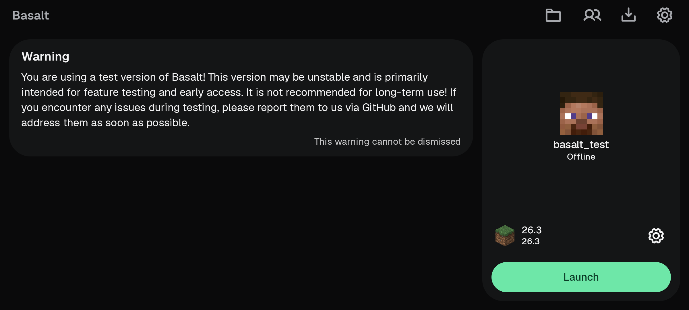
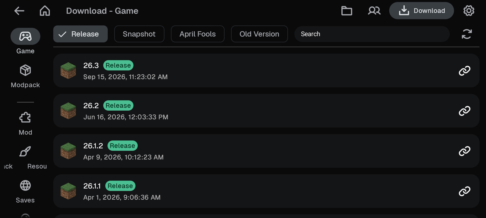
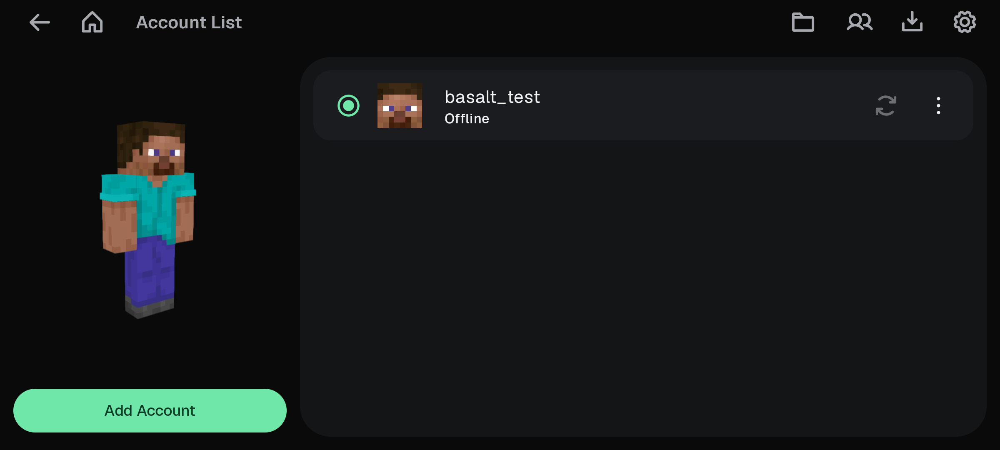
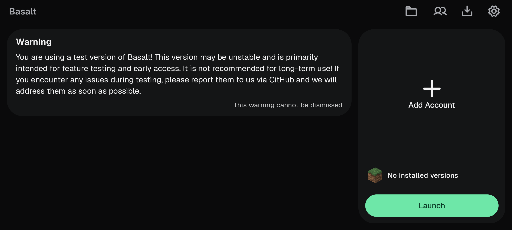

# Basalt

A Minecraft: Java Edition launcher for Android, focused on offline (offline-mode)
accounts, modern versions, and honest performance tuning on phone-class hardware.

Basalt is a fork of [ZalithLauncher 2](https://github.com/ZalithLauncher/ZalithLauncher2)
(GPL-3.0) by MovTery and contributors. The runtime core (the Android JVM port,
LWJGL patches, GL renderers, input bridge) is upstream GPL code, credited and
unchanged in lineage. The product layer in this fork is rebuilt: locked dark
theme with a single emerald accent, Geist typography, Phosphor bold icon set,
offline-account-first flows, device-proportional memory defaults, a tuned G1
baseline for the game JVM, and a fresh brand identity.

This launcher is not affiliated with, endorsed by, or connected to Mojang
Studios or Microsoft. Java Edition game files are downloaded at runtime from
Mojang's own public endpoints. Playing multiplayer on online-mode servers
requires a legitimate Minecraft account; offline accounts exist for offline
play and offline-mode servers.

## Downloads

| Platform | Build | Where |
|---|---|---|
| Android (arm64) | `Basalt-2.0.0-arm64-v8a.apk` | [GitHub releases](https://github.com/loak7993-code/basalt/releases) |
| Android (any ABI) | `Basalt-2.0.0-universal.apk` | [GitHub releases](https://github.com/loak7993-code/basalt/releases) |
| Linux x86_64 | `Basalt-2.0.0-x86_64.AppImage` (6.6 MB) | [GitHub releases](https://github.com/loak7993-code/basalt/releases) |

Binaries ship as release assets, not as commits.

## Features

- Java Edition from 1.7 up to the current drop, MC 26.3 included (Java 25 runtime bundled)
- Offline accounts first: the login menu opens on offline login; Microsoft and
  authlib-injector accounts still work
- Version install from the official Mojang manifest, with parallel download and
  SHA1 verification
- Renderer options (gl4es, ANGLE, Zink, VirGL) from the upstream plugin ecosystem
- Virtual mouse, joystick, gyroscope, gamepad support; control layout editor
- Terracotta multiplayer rooms, mod loader installs (Forge/Fabric/NeoForge/OptiFine/Quilt)
- Locked dark interface: near-black canvas, single emerald accent, Geist Sans/Mono,
  Phosphor bold icons

## Screenshots

Real captures from the verification run on an Android 15 emulator (2400x1080):

| | |
|---|---|
|  |  |
|  |  |

## Quick start

Build:

```bash
git clone https://github.com/loak7993-code/basalt.git
cd basalt
./gradlew :ZalithLauncher:assembleDebug
```

The debug APK lands in `ZalithLauncher/build/outputs/apk/debug/`. Install it on
an Android 8.0+ (API 26) device and allow install-from-unknown-sources.

First run on the device:

1. The launcher unpacks its bundled Java runtimes (one-time).
2. Add an offline account: Accounts, then pick Offline, and type a name.
3. Download: Game, pick 26.3 (top of the Releases list), install.
4. Home: pick the version card, Launch.

## Configuration

No build-time configuration is required. Optional properties live in
`ZalithLauncher/gradle.properties`:

| Property | Purpose | Default |
|---|---|---|
| `launcher_name` | App label + data-dir identity | `Basalt` |
| `launcher_app_name` | Full display name | `Basalt` |
| `launcher_short_name` | Short name used in user agents | `Basalt` |
| `url_home` | Fork home page (update/about links) | `https://github.com/loak7993-code/basalt` |
| `launcher_version_code` | Android versionCode | `20000` |
| `launcher_version_name` | Android versionName | `2.0.0` |
| `basalt_store_password` | Release keystore password (unset in git) | from env `STORE_PASSWORD` or `.store_password.txt` |
| `basalt_key_password` | Release key password (unset in git) | from env `KEY_PASSWORD` or `.key_password.txt` |
| `oauth_client_id` | Microsoft OAuth client id for MS login | unset (offline login needs none) |
| `curseforge_api_key` | CurseForge API key for mod downloads | unset |

In-app settings that matter for performance live under Settings: memory
allocation (defaults to ~55% of device RAM, minimum 1536 MB where the device
allows), renderer selection, and custom JVM args. When no custom GC is set, the
launcher injects a tuned G1 baseline (`G1NewSizePercent=20`,
`G1ReservePercent=20`, `MaxGCPauseMillis=40`, `G1HeapRegionSize=16M`).

## Build, test, deploy

```bash
./gradlew :engine:test                             # Kotlin engine tests (real 26.3 manifest)
cd engine-rs && cargo test                         # Rust engine tests + device parity test
cd engine-rs && cargo build --release --target aarch64-linux-android && \
  cargo build --release --target x86_64-linux-android   # rebuild libbasalt_engine.so
./gradlew :ZalithLauncher:assembleDebug            # universal debug APK
./gradlew :ZalithLauncher:assembleDebug -Darch=x86_64   # single-ABI debug APK
./gradlew :ZalithLauncher:assembleRelease          # release APK, signed with basalt.jks
./gradlew :ZalithLauncher:assembleRelease -Darch=arm64  # arm64-only release APK
```

Builds need JDK 21 (the toolchain compiles with it) and an Android SDK with
platform 37, build-tools 37, NDK 25.2.9519653, and accepted licenses.

## Architecture

```
Basalt/
  engine-rs/             the launch engine in Rust (crate basalt_engine):
                         manifest parsing, library rules, classpath, memory/GC
                         policy, arg assembly, exec strategy, JNI surface;
                         cargo test runs against the real 26.3 manifest
  cli/                   the Linux launcher (basalt CLI): install, list, play,
                         offline accounts; packaged as an AppImage
  packaging/appimage/    AppDir + build recipe for the AppImage
  website/               the product site (Vite + React + Tailwind v4)
  engine/                the Kotlin reference engine (same scope, same tests)
  ZalithLauncher/        the app: Compose UI, settings, accounts, downloads, launch pipeline
    src/main/java/com/movtery/zalithlauncher/
      game/launch/       JVM launch pipeline, arg assembly, GC policy via Rust
      engine/            RustEngine JNI bridge with Kotlin fallback
      game/download/     version/asset download engine (official Mojang endpoints)
      ui/screens/        Compose screens (home, download, accounts, settings, game)
      ui/theme/          Basalt palette, Geist typography
      components/jre/    bundled runtime unpacking (jre-8/17/21/25)
      jni/               native bridge (EGL/input/linker hooks), upstream
      jniLibs/           libbasalt_engine.so (x86_64, arm64) built by cargo
    src/main/assets/runtimes/  bionic JRE builds per Java version
  LWJGL/                 upstream patched LWJGL (3.3.3, 3.4.1)
  Terracotta/            multiplayer room client
  Guide/ CardGrid/ ColorPicker/ InputMap/ LayerController/   UI modules
```

## Known limitations

- Verified here only on an x86_64 emulator (API 35): install, theme, screens,
  navigation, settings. Real-device launch of MC 26.3 was not tested in this
  environment; on-device rendering depends on the device GPU and chosen renderer.
- Microsoft login is disabled by default (no OAuth client id configured).
  Configure `oauth_client_id` with your own Azure app id to enable it.
- The in-app upgrade check points at the fork's info repo; while that repo has
  no release metadata, the check quietly reports nothing.
- Upstream seasonal festival effects are off by default.
- Modloader installers for versions newer than 26.3 depend on the upstream
  modloader metadata sources catching up.
- The release keystore is not in this repository. `assembleRelease` needs your
  own `ZalithLauncher/basalt.jks` plus `STORE_PASSWORD` / `KEY_PASSWORD` in the
  environment (or the untracked `.store_password.txt` / `.key_password.txt`).
  Debug builds sign with the committed public debug key and need nothing.

## License

GPL-3.0-or-later, inherited from [ZalithLauncher 2](https://github.com/ZalithLauncher/ZalithLauncher2)
by MovTery and contributors. Full text in [LICENSE](LICENSE).

Engine boundary: the launch engine (`engine-rs/`, `cli/`) is first-party work in
this repository. The Android runtime core (bionic JRE builds, patched LWJGL,
GL renderers, input bridge) is upstream GPL code, kept with its lineage intact.
See [PROVENANCE.md](PROVENANCE.md) for the line between the two.
